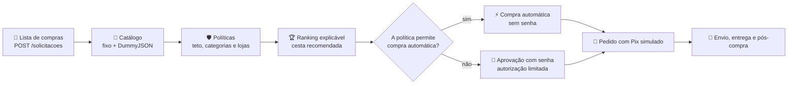
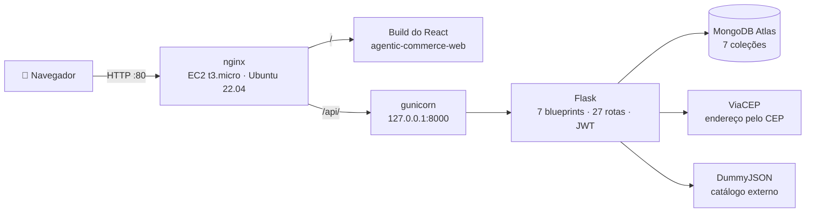
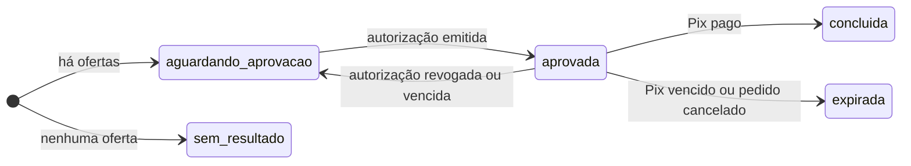
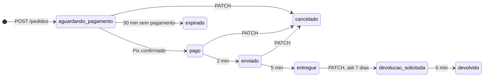

<div align="center">

# 🛒 Agentic Commerce · API

**Compra de supermercado por intenção, com autonomia controlada.**

Você escreve a lista de compras e define as regras. O agente busca, compara, explica e compra só o que cabe nelas,<br>
com cada passo registrado numa trilha de auditoria.

[](http://54.209.228.101)
[](http://54.209.228.101/api/health)


**[🌐 Aplicação](http://54.209.228.101)** ·
**[💻 Front-end](https://github.com/iajuss/agentic-commerce-web)** ·
**[📄 Contrato da API](docs/plano-backend/00-contrato-de-integracao.md)** ·
**[📮 Coleção Postman](docs/agentic-commerce.postman_collection.json)**

</div>

---

## 📑 Sumário

- [🌐 Produção](#-produção)
- [👥 Equipe](#-equipe)
- [🧭 Como funciona](#-como-funciona)
- [🧱 Arquitetura](#-arquitetura)
- [🎯 Requisitos da disciplina](#-requisitos-da-disciplina)
- [🧰 Tecnologias](#-tecnologias)
- [💻 Como rodar localmente](#-como-rodar-localmente)
- [🔐 Variáveis de ambiente](#-variáveis-de-ambiente)
- [📡 Rotas da API](#-rotas-da-api)
- [📏 Convenções REST](#-convenções-rest)
- [🛒 Regras de negócio](#-regras-de-negócio)
- [🔗 O que o front precisa saber](#-o-que-o-front-precisa-saber)
- [🔌 APIs externas](#-apis-externas)
- [🧪 Testes](#-testes)
- [📮 Coleção Postman e ensaio ponta a ponta](#-coleção-postman-e-ensaio-ponta-a-ponta)
- [🚀 Deploy na EC2](#-deploy-na-ec2)
- [🚧 Limitações do MVP](#-limitações-do-mvp)
- [📁 Estrutura do repositório](#-estrutura-do-repositório)
- [📚 Documentação](#-documentação)
- [🤝 Como contribuir](#-como-contribuir)

## 🌐 Produção

O front e a API rodam juntos numa **AWS EC2** (t3.micro, Ubuntu 22.04 LTS): o nginx serve o build do React na raiz e
encaminha `/api/` para o gunicorn, que roda esta API Flask.

| O quê | Endereço |
|---|---|
| 🌐 Aplicação (React) | <http://54.209.228.101> |
| 🔌 API (Flask) | `http://54.209.228.101/api` + a rota (ex.: `/api/politicas`) |
| 🩺 Saúde da API e do Atlas | <http://54.209.228.101/api/health> → `{"banco": "ok", "status": "ok"}` |
| 💻 Repositório do front-end | <https://github.com/iajuss/agentic-commerce-web> |

> [!WARNING]
> A EC2 serve só HTTP, sem TLS. Para testar, crie uma conta em **Criar conta** com um e-mail de teste e **não use uma
> senha real**.

## 👥 Equipe

Projeto da disciplina **Programação Eficaz**, apresentado em 03/11/2026.

<table>
  <tr>
    <td align="center" width="20%">
      <a href="https://github.com/TucaAR15"><br><b>Arthur Azevedo</b></a><br><sub>@TucaAR15</sub>
    </td>
    <td align="center" width="20%">
      <a href="https://github.com/iajuss"><br><b>Davi Damazio</b></a><br><sub>@iajuss</sub>
    </td>
    <td align="center" width="20%">
      <a href="https://github.com/lucascruzfinance"><br><b>Lucas Cruz</b></a><br><sub>@lucascruzfinance</sub>
    </td>
    <td align="center" width="20%">
      <a href="https://github.com/Lucas-Ibanez"><br><b>Lucas Ibanez</b></a><br><sub>@Lucas-Ibanez</sub>
    </td>
    <td align="center" width="20%">
      <a href="https://github.com/RFontes13RF"><br><b>Ryan Fontes</b></a><br><sub>@RFontes13RF</sub>
    </td>
  </tr>
</table>

## 🧭 Como funciona

1. 📝 **Você escreve a lista** em texto livre, com quantidades: `arroz 5kg, 2 leites integrais e detergente`.
2. 🔎 **O agente busca e filtra:** consulta o catálogo e descarta o que as suas políticas não permitem.
3. 🏆 **Você vê a cesta explicada:** uma oferta por item, até 4 alternativas e o motivo de cada escolha, com números.
4. ✅ **Você aprova, ou ele compra sozinho:** no modo manual, a compra pede a sua senha; no automático, o agente compra
   sem senha, até o teto da política.
5. 💸 **Pix, entrega e auditoria:** Pix simulado, envio, entrega, devolução e chamados, com cada passo registrado.



## 🧱 Arquitetura



- **Monolito modular:** um blueprint do Flask por módulo do diagrama de pacotes, registrado em `app/__init__.py`.
- **O React nunca chama o banco nem as APIs externas:** tudo passa por esta API, que guarda as credenciais em variáveis
  de ambiente.
- **JWT global:** `proteger_rotas` exige token em toda rota, exceto `GET /health`, `POST /usuarios` e `POST /sessoes`.
  Uma rota nova já nasce protegida.
- **Dados no MongoDB Atlas:** 7 coleções (`usuarios`, `politicas`, `solicitacoes`, `autorizacoes`, `pedidos`,
  `chamados` e `auditoria`), com os índices criados na inicialização da API.

| Módulo | Pasta | Rotas |
|---|---|---|
| 🩺 Saúde | `app/saude.py` | `/health` |
| 🔐 Autenticação e perfil | `app/autenticacao/` | `/usuarios`, `/sessoes`, `/usuarios/me` |
| 🛡️ Políticas e governança | `app/politicas/` | `/politicas` |
| 🧠 Orquestrador de solicitações | `app/solicitacoes/` | `/solicitacoes` |
| 💳 Aprovação e pagamento | `app/pagamento/` | `/solicitacoes/{id}/autorizacoes`, `/autorizacoes`, `/pedidos`, `/simulador-pix/pagamentos` |
| 📦 Pós-compra | `app/pos_compra/` | `/pedidos/{id}`, `/pedidos/{id}/chamados` |
| 📜 Auditoria | `app/auditoria/` | `/auditoria` |

No MVP, o backend foi dividido em três módulos independentes (M1 Conta, Auditoria e Plataforma; M2 Descoberta e
Solicitações; M3 Aprovação, Pagamento e Pós-compra), ligados só pelo
[contrato de integração](docs/plano-backend/00-contrato-de-integracao.md): documentos no MongoDB, a API HTTP e três
ganchos em `app.extensions` (`registrar_evento`, `compra_automatica` e `expirar_autorizacoes`).

## 🎯 Requisitos da disciplina

✅ Servidor em Flask · ✅ Cliente em React · ✅ REST nível 2 · ✅ MongoDB Atlas · ✅ Deploy na EC2 ·
✅ API externa (DummyJSON e ViaCEP) · ✅ Repositórios separados · ✅ Credenciais fora do Git

| Conceito | Critério | Onde conferir |
|---|---|---|
| **C+** | Rotas com dados no Atlas, catálogo externo no ranking e cada rota usada por uma tela do React | 27 rotas, todas chamadas pelo [front](https://github.com/iajuss/agentic-commerce-web#-telas-e-rotas-da-api); ofertas da DummyJSON no ranking |
| **B** | API na EC2, com o link no README da API | <http://54.209.228.101/api/health> |
| **B+** | pytest cobrindo todas as rotas, com catálogo e pagamento mockados | 589 testes, sem rede e sem Atlas ([Testes](#-testes)) |
| **A** | Cadastro, login e rotas protegidas por JWT | `proteger_rotas` em `app/__init__.py`; login, logout e rotas privadas no React |
| **A+** | Build do React servido pelo nginx na EC2, com o link no README do front | <http://54.209.228.101> |

## 🧰 Tecnologias

| Camada | Tecnologia |
|---|---|
| 🐍 Linguagem | Python 3.12 em produção (mínimo 3.11, exigido pelo PyMongo 4.19) |
| ⚗️ Framework | Flask 3.1 (app factory e blueprints) e Flask-CORS 6 |
| 🔐 Autenticação | Flask-JWT-Extended 4.7 (Bearer JWT) e senhas com hash do Werkzeug |
| 🍃 Banco | MongoDB Atlas via PyMongo 4.19 |
| 🔌 Integrações | Requests 2.34 (ViaCEP e DummyJSON) |
| 🚀 Servidor | gunicorn 26, nginx e systemd numa AWS EC2 |
| 🧪 Testes | pytest 9 e mongomock 4.3 (banco em memória) |
| ⚙️ Configuração | python-dotenv (`.env` no desenvolvimento) |

## 💻 Como rodar localmente

**Pré-requisitos:** Python 3.11 ou mais novo e uma string de conexão do MongoDB Atlas, com o seu IP liberado em
*Network Access*.

```bash
git clone https://github.com/iajuss/agentic-commerce-api.git
cd agentic-commerce-api

python -m venv .venv
.venv\Scripts\activate             # Windows (Linux/macOS: source .venv/bin/activate)
pip install -r requirements.txt

copy .env.example .env             # Windows (Linux/macOS: cp .env.example .env)
python scripts/testar_atlas.py     # opcional: confere a conexão com o Atlas
flask --app wsgi run --debug       # http://localhost:5000/health
```

Preencha no `.env` pelo menos `MONGO_URI` e `JWT_SECRET_KEY`; sem elas, a API não sobe. Para gerar a chave:

```bash
python -c "import secrets; print(secrets.token_hex(32))"
```

> [!TIP]
> Com a API rodando, suba o [front-end](https://github.com/iajuss/agentic-commerce-web) com `pnpm dev`: ele chama
> `http://localhost:5000` por padrão, e o `CORS_ORIGINS` padrão já libera `http://localhost:5173`.

## 🔐 Variáveis de ambiente

Copie `.env.example` para `.env` e preencha os valores no arquivo ignorado pelo Git. O `.env.example` só traz os nomes
e os padrões; os valores reais circulam por canal privado do time, e os de produção vão para o professor pelo
Blackboard.

| Variável | Padrão | Para quê |
|---|---|---|
| `MONGO_URI` | **obrigatória** | String `mongodb+srv://` do Atlas |
| `MONGO_DB_NAME` | `agentic_commerce` | Nome do banco (cada dev pode usar o seu) |
| `JWT_SECRET_KEY` | **obrigatória** | Chave que assina os tokens JWT |
| `JWT_EXPIRA_HORAS` | `8` | Validade do token de login, em horas |
| `CORS_ORIGINS` | `http://localhost:5173` | Origens do front liberadas, separadas por vírgula |
| `HTTP_TIMEOUT_SEGUNDOS` | `8` | Timeout das chamadas ao ViaCEP e à DummyJSON |
| `PROXY_FIX` | `0` | `1` atrás do nginx em `/api` (o `Location` ganha o prefixo `/api`) |
| `CATALOGO_PROVEDOR` | `fixo` | `fixo` (local, sem rede), `dummyjson` (API externa) ou `combinado` (os dois; produção) |
| `PIX_EXPIRACAO_MINUTOS` | `30` | Validade da cobrança Pix simulada |
| `AUTORIZACAO_VALIDADE_MINUTOS` | `15` | Validade da autorização limitada |
| `SIMULACAO_ENVIO_MINUTOS` | `2` | Minutos entre o pagamento e o envio simulado |
| `SIMULACAO_ENTREGA_MINUTOS` | `5` | Minutos entre o envio e a entrega simulada |
| `ML_CLIENT_ID`, `ML_CLIENT_SECRET`, `ML_REDIRECT_URI`, `ML_REFRESH_TOKEN`, `ML_VENDEDORES` | vazio | Reservadas para o conector do Mercado Livre, fora do MVP: deixe vazias |

## 📡 Rotas da API

Em produção, todas ficam sob `/api` (ex.: `http://54.209.228.101/api/politicas`). As marcadas com 🔓 são públicas; as
demais exigem `Authorization: Bearer <token>`.

| Módulo | Método | Rota | O que faz | Sucesso |
|---|---|---|---|---|
| Saúde | `GET` | `/health` 🔓 | Confere a API e a conexão com o Atlas | `200` (`503` sem banco) |
| Conta | `POST` | `/usuarios` 🔓 | Cadastro | `201` |
| Conta | `POST` | `/sessoes` 🔓 | Login; devolve o JWT | `200` |
| Conta | `GET` | `/usuarios/me` | Perfil, preferências e orçamento | `200` |
| Conta | `PATCH` | `/usuarios/me` | Atualiza o perfil; completa o endereço pelo ViaCEP | `200` |
| Políticas | `GET` | `/politicas` | Lista as políticas | `200` |
| Políticas | `POST` | `/politicas` | Cria uma política | `201` |
| Políticas | `GET` | `/politicas/{id}` | Obtém uma política | `200` |
| Políticas | `PUT` | `/politicas/{id}` | Substitui uma política | `200` |
| Políticas | `DELETE` | `/politicas/{id}` | Remove uma política | `204` |
| Solicitações | `POST` | `/solicitacoes` | Lista de compras → catálogo → políticas → ranking → cesta | `201` |
| Solicitações | `GET` | `/solicitacoes` | Histórico (resumo) | `200` |
| Solicitações | `GET` | `/solicitacoes/{id}` | Solicitação completa, com a explicação | `200` |
| Solicitações | `DELETE` | `/solicitacoes/{id}` | Cancela antes da aprovação | `204` |
| Pagamento | `POST` | `/solicitacoes/{id}/autorizacoes` | Aprova com a senha e emite a autorização limitada | `201` |
| Pagamento | `GET` | `/autorizacoes` | Lista as autorizações ativas | `200` |
| Pagamento | `GET` | `/autorizacoes/{id}` | Obtém uma autorização | `200` |
| Pagamento | `DELETE` | `/autorizacoes/{id}` | Revoga uma autorização | `204` |
| Pagamento | `POST` | `/pedidos` | Usa a autorização (uso único) e gera a cobrança Pix | `201` |
| Pagamento | `GET` | `/pedidos` | Lista os pedidos | `200` |
| Pagamento | `POST` | `/simulador-pix/pagamentos` | Simula o pagamento de um Pix (demonstração) | `200` |
| Pós-compra | `GET` | `/pedidos/{id}` | Comprovante e status atual | `200` |
| Pós-compra | `PATCH` | `/pedidos/{id}` | Pede cancelamento ou devolução | `200` |
| Pós-compra | `POST` | `/pedidos/{id}/chamados` | Abre um chamado de pós-venda | `201` |
| Pós-compra | `GET` | `/pedidos/{id}/chamados` | Lista os chamados do pedido | `200` |
| Pós-compra | `GET` | `/pedidos/{id}/chamados/{chamado_id}` | Obtém um chamado | `200` |
| Auditoria | `GET` | `/auditoria?limite=50&antes_de={id}` | Trilha de eventos, paginada (1 a 100 por página) | `200` |

Os erros possíveis de cada rota e o formato completo de cada resposta estão nas seções 2 e 10 do
[contrato de integração](docs/plano-backend/00-contrato-de-integracao.md).

## 📏 Convenções REST

A API segue o **nível 2 de Richardson**:

- Recursos no plural e nenhum verbo na URI: mudar estado é `PATCH` no recurso (ex.: cancelar um pedido é
  `PATCH /pedidos/{id}` com `{"status": "cancelado"}`).
- Criar responde `201` com o cabeçalho `Location`; excluir ou revogar responde `204` sem corpo. `PUT` substitui o
  recurso inteiro; `PATCH` altera em parte.
- Erros sempre em JSON, com a mensagem pronta para mostrar ao usuário:
  `{"erro": "Política inválida.", "detalhes": {"teto_por_compra": "Informe um valor maior que zero."}}`.
- Códigos de erro: `400` corpo inválido · `401` sem token, token inválido ou senha errada · `404` recurso inexistente
  **ou de outro usuário** · `409` conflito com o estado atual · `422` compra recusada pela política · `502` serviço
  externo fora do ar · `503` banco indisponível (só no `/health`).
- Os documentos guardam o `usuario_id`, e toda consulta filtra por ele: o recurso de outra pessoa responde `404`.
- Ids são texto, datas vêm em ISO 8601 (UTC) e valores em reais são números com 2 casas.

## 🛒 Regras de negócio

### Políticas de compra

```json
{
  "nome": "Mercado do mês",
  "teto_por_compra": 300,
  "categorias": ["mercearia", "laticínios", "casa e limpeza"],
  "lojas": [],
  "nivel_autonomia": "automatica",
  "ativa": true
}
```

- O teto vale para a **cesta inteira**: itens mais frete.
- `categorias` e `lojas` vazias aceitam qualquer uma; a comparação ignora maiúsculas e acentos.
- A categoria é comparada com o caminho da oferta (`categorias_caminho`): "bebidas" aceita uma cerveja cujo caminho é
  "Alimentos e Bebidas > Bebidas > Bebidas Alcoólicas > Cervejas". No catálogo do MVP existem, entre outras, Alimentos e
  Bebidas, Mercearia, Laticínios, Bebidas, Bebidas Alcoólicas, Casa e Limpeza, Higiene e Cuidado Pessoal e Padaria.
- `nivel_autonomia`: `manual` (padrão; o usuário aprova cada compra com a senha) ou `automatica` (o agente compra
  sozinho quando a cesta cabe na política).
- A cesta é permitida se uma mesma política ativa aceita todos os itens e o total cabe no teto; se várias aceitam,
  vale a que dá mais autonomia. **Sem nenhuma política ativa, tudo é permitido, mas sempre com aprovação manual.**

O validador fica em `app/politicas/regras.py`: o orquestrador usa `avaliar_cesta` na cesta recomendada e
`avaliar_oferta` em cada oferta.

```python
from app.politicas import repositorio
from app.politicas.regras import avaliar_oferta

avaliacao = avaliar_oferta(oferta, repositorio.listar(usuario_id))
avaliacao.permitida          # alguma política ativa aceita a oferta?
avaliacao.compra_automatica  # o agente pode comprar sem pedir a senha?
avaliacao.motivos            # por que as políticas recusaram (para a explicação)
```

### Lista de compras

- `POST /solicitacoes` recebe **um** de `{"texto": "arroz 5kg, 2 leites e detergente"}` (3 a 500 caracteres) ou
  `{"itens": [{"descricao": "arroz 5kg", "quantidade": 1}]}` (1 a 20 itens; quantidade de 1 a 99).
- O texto é interpretado por regras, sem LLM: separa os itens por vírgula, ponto e vírgula, quebra de linha ou "e", e
  lê quantidades em dígitos ("2 leites", "2x leite") ou por extenso, de um a dez ("duas caixas de sabão em pó").
  "2 kg de feijão" é medida, não quantidade.
- A quantidade vira número de embalagens: "2 kg de feijão" com a oferta de 1 kg vira 2 embalagens, e a explicação do
  item conta o ajuste.
- Bebidas alcoólicas só entram nas ofertas de quem informou a data de nascimento no perfil e tem 18 anos ou mais.

### Ranking explicável

Cada oferta recebe uma nota de 0 a 1 por critério, e a pontuação é a soma ponderada (`app/solicitacoes/ranking.py`):

| Critério | Peso | Como entra na nota |
|---|---|---|
| 💰 Preço | 50% | Preço por kg, litro ou unidade, proporcional ao menor do conjunto e contando só o que atende ao pedido |
| 🚚 Frete | 20% | Posição entre o menor e o maior frete; frete não informado conta como R$ 15,00 |
| ⏱️ Prazo | 15% | Posição entre o menor e o maior prazo de entrega |
| ⭐ Avaliação | 15% | Nota da loja dividida por 5 |

A marca preferida do perfil ganha **+0,10**, a embalagem igual à pedida ganha **+0,15** ("arroz 5kg" prefere o pacote
de 5 kg) e a marca evitada perde **0,20**. Critério sem dado recebe a nota neutra (0,5). Cada item traz a recomendada,
até 4 alternativas e frases com números, como "Menor preço por kg entre 6 ofertas: R$ 5,58/kg" e "Frete grátis".

### Catálogo

| Provedor | O que é | Quando usar |
|---|---|---|
| `fixo` | 44 ofertas de supermercado em português, em 4 lojas fictícias, sem rede | Padrão no desenvolvimento e nos testes |
| `dummyjson` | Produtos da categoria `groceries` da DummyJSON (API externa, sem chave), com o termo traduzido para o inglês | Testar só o catálogo externo |
| `combinado` | `fixo` + DummyJSON no mesmo ranking; se um cair, a busca segue com o outro | Produção e demonstração |

### Aprovação, pagamento e pós-compra

- 🔐 **Aprovação manual:** `POST /solicitacoes/{id}/autorizacoes` com `{"senha": "..."}` pede a senha de novo e emite
  uma **autorização limitada**: uso único, válida por 15 minutos e com valor máximo igual ao total da cesta.
- ⚡ **Compra automática:** quando a cesta cabe numa política `automatica`, o próprio `POST /solicitacoes` emite a
  autorização e cria o pedido com o Pix, sem pedir a senha.
- 💸 **Pix simulado:** `POST /pedidos` usa a autorização e gera a cobrança (`PIX-SIMULADO-...`), válida por 30 minutos;
  `POST /simulador-pix/pagamentos` confirma o pagamento.
- 🚚 **Envio e entrega simulados:** o pedido é enviado 2 minutos depois do pagamento e entregue 5 minutos depois do
  envio. As transições são aplicadas na leitura do pedido.
- ↩️ **Cancelamento e devolução:** `PATCH /pedidos/{id}` cancela antes da entrega ou pede a devolução em até 7 dias
  depois dela (direito de arrependimento, CDC, art. 49); o reembolso é simulado.
- 📜 **Auditoria:** cada passo vira um evento numa trilha só de inserção, sem senha, hash, token nem código Pix.

<details>
<summary><b>Máquinas de estado da solicitação e do pedido</b></summary>





</details>

## 🔗 O que o front precisa saber

- **Senha errada na aprovação:** `POST /solicitacoes/{id}/autorizacoes` responde `401` com `detalhes.senha`; a sessão
  continua e a tela pede a senha de novo. Um `401` sem `detalhes` (token inválido, vencido ou de usuário inexistente)
  encerra a sessão.
- **Autorização:** vale 15 minutos e um uso só. Se o pedido não for criado nesse prazo, ela fica `expirada` e a
  solicitação volta de `aprovada` para `aguardando_aprovacao`: dá para aprovar de novo ou cancelar.
  `GET /autorizacoes` lista só as ativas.
- **Transições simuladas:** expiração do Pix, envio, entrega e devolução acontecem sozinhas e são aplicadas na leitura
  (`GET /pedidos/{id}`, `GET /pedidos`). O comprovante só mostra o `copia_e_cola` enquanto o pedido aguarda pagamento.
- **Perfil:** `PATCH /usuarios/me` aceita qualquer subconjunto dos campos; `"endereco": null` apaga o endereço. O CEP
  volta com máscara (`01001-000`), e o erro de CEP inexistente vem em `detalhes["endereco.cep"]`.
- **Cancelar solicitação:** `DELETE /solicitacoes/{id}` só vale antes da aprovação e remove o documento; o histórico
  continua na auditoria.
- O formato completo de cada resposta está na seção 10 do
  [contrato de integração](docs/plano-backend/00-contrato-de-integracao.md).

## 🔌 APIs externas

| Serviço | Para quê | Se ficar fora do ar |
|---|---|---|
| 📮 [ViaCEP](https://viacep.com.br) | Completa o endereço no `PATCH /usuarios/me` | O perfil responde `502` com uma mensagem para o usuário |
| 🛍️ [DummyJSON](https://dummyjson.com) | Catálogo externo (`groceries`) no ranking da cesta, com cache de 10 minutos | O catálogo `combinado` segue só com o `fixo` e tenta de novo depois de 60 segundos |

Nenhuma das duas usa chave. Na EC2, use `CATALOGO_PROVEDOR=combinado`; no desenvolvimento, o `fixo` funciona sem
acesso à rede. O React chama somente esta API Flask.

## 🧪 Testes

```bash
pytest                          # suíte completa: 589 testes
pytest tests/test_ranking.py    # um arquivo
pytest -k devolucao             # filtra pelo nome
```

- 🍃 **Banco em memória:** os testes usam o `mongomock`; não precisam do Atlas nem do `.env`.
- 🚫 **Sem rede:** uma fixture `autouse` do `tests/conftest.py` troca `requests.Session.request` por uma função que
  falha; ViaCEP e DummyJSON são mockados com as respostas de `tests/fixtures/`.
- 📜 **Contrato:** `tests/test_contrato*.py` confere as 27 rotas, os códigos HTTP e o `401` sem token.
- ⏱️ **Tempo simulado:** cada módulo lê a hora por uma função `agora()`, que os testes trocam para simular o Pix
  vencido, o envio e a entrega.

| Área | Arquivos em `tests/` |
|---|---|
| App, configuração e contrato | `test_app`, `test_config`, `test_indices`, `test_contrato*` |
| Conta, políticas e auditoria | `test_autenticacao`, `test_perfil`, `test_politicas`, `test_regras`, `test_auditoria` |
| Descoberta e solicitações | `test_solicitacoes`, `test_catalogo*`, `test_intencao`, `test_medidas`, `test_ranking`, `test_regras_cesta` |
| Aprovação, pagamento e pós-compra | `test_autorizacoes`, `test_pedidos`, `test_compra_automatica`, `test_pos_compra`, `test_chamados` |
| Fluxo completo | `test_fluxo_completo`, `test_ensaio_ponta_a_ponta` |

## 📮 Coleção Postman e ensaio ponta a ponta

### Coleção de requisições

[`docs/agentic-commerce.postman_collection.json`](docs/agentic-commerce.postman_collection.json) importa no Postman ou
no Insomnia. São 35 requisições em 8 pastas por módulo, cobrindo as 27 rotas, com recursos de teste separados para
revogação, cancelamento e devolução. Cadastro e Login guardam o token para as requisições seguintes.

- `baseUrl` começa em `http://localhost:5000`; para usar a produção, troque por `http://54.209.228.101/api`.
- Para executar a coleção inteira, use o Runner com intervalo de 5 segundos entre requisições: ele consulta o pedido
  até a entrega simulada, por até nove minutos. Com as simulações zeradas, só no ambiente local, o intervalo pode ser
  menor.
- A execução cria contas e pedidos de teste no banco configurado.

### Ensaio ponta a ponta

Com a API em execução, o script percorre os fluxos automático e manual de verdade, via HTTP:

```bash
python scripts/ensaio_ponta_a_ponta.py --base-url http://localhost:5000
python scripts/ensaio_ponta_a_ponta.py --base-url http://54.209.228.101/api   # produção (catálogo combinado)
```

O ensaio cria duas contas de teste, consulta o ViaCEP pelo CEP `01001000`, percorre os dois fluxos e aguarda a entrega
simulada por até oito minutos. `--item` escolhe um produto existente no catálogo configurado (padrão: `arroz`) e
`--limite-entrega-segundos` muda a espera (padrão: 480). O script sai com código diferente de zero se algum passo
falhar. Para exercitar o catálogo externo localmente, inicie a API com `CATALOGO_PROVEDOR=dummyjson` no ambiente do
processo.

## 🚀 Deploy na EC2

A produção roda em <http://54.209.228.101>, numa t3.micro com Ubuntu 22.04 LTS:

- **nginx** (porta 80) serve o build do React em `/` e encaminha `/api/` para o gunicorn, com gzip, cache e cabeçalhos
  de segurança (CSP, `X-Frame-Options`, `nosniff`).
- **gunicorn** roda a API em `127.0.0.1:8000` (2 workers), como o serviço `agentic-commerce-api` do systemd.
- O clone fica em `/opt/agentic-commerce-api`, as variáveis em `/etc/agentic-commerce-api.env` (dono `root`, modo
  `600`) e as versões do front em `/var/www/agentic-commerce-web`, onde o nginx serve o link `atual`.

| Arquivo em `deploy/` | Para quê |
|---|---|
| `agentic-commerce-api.service` | Serviço do systemd que sobe o gunicorn com o arquivo de ambiente |
| `gunicorn.conf.py` | Endereço, workers, timeout e logs do gunicorn |
| `nginx-agentic-commerce.conf` | Site do nginx: React em `/`, API em `/api/`, cache e rotas do React |
| `nginx-agentic-commerce-cabecalhos.conf` | Cabeçalhos de segurança, incluídos em cada `location` |
| `atualizar.sh` | Atualiza o clone da `main`, instala as dependências, reinicia e confere o `/health` |
| `publicar-front.sh` | Publica um build do React com versões, troca atômica e retorno automático |

<details>
<summary><b>Instalação do zero, passo a passo</b></summary>

1. Use uma instância t2.micro ou t3.micro com Ubuntu 22.04 ou 24.04 LTS. Restrinja o SSH (porta 22) ao IP de
   administração e abra o HTTP (porta 80). O IP público precisa ser fixo (Elastic IP), porque o Atlas libera o acesso
   por IP.
2. Entre por SSH como `ubuntu` e prepare o clone da branch `main`. O PyMongo 4.19 exige Python 3.11 ou mais novo: no
   Ubuntu 24.04, o `python3` do sistema (3.12) serve; no 22.04, que vem com o 3.10, instale o 3.12 pelo PPA deadsnakes:

   ```bash
   sudo apt update
   sudo apt install -y python3-venv git nginx curl
   sudo add-apt-repository -y ppa:deadsnakes/ppa     # só no Ubuntu 22.04
   sudo apt install -y python3.12 python3.12-venv    # só no Ubuntu 22.04
   sudo mkdir -p /opt/agentic-commerce-api
   sudo chown ubuntu:ubuntu /opt/agentic-commerce-api
   git clone https://github.com/iajuss/agentic-commerce-api.git /opt/agentic-commerce-api
   cd /opt/agentic-commerce-api
   python3.12 -m venv .venv
   .venv/bin/python -m pip install -r requirements.txt
   .venv/bin/python -m pytest -q                     # a suíte não usa o Atlas
   ```

3. Crie o arquivo de ambiente fora do clone e edite-o diretamente na instância:

   ```bash
   sudo touch /etc/agentic-commerce-api.env
   sudo chown root:root /etc/agentic-commerce-api.env
   sudo chmod 600 /etc/agentic-commerce-api.env
   sudoedit /etc/agentic-commerce-api.env
   ```

   Preencha as chaves do `.env.example` com os valores de produção: `MONGO_URI` entre aspas simples (a URI tem `&`),
   `MONGO_DB_NAME=agentic_commerce`, um `JWT_SECRET_KEY` gerado na própria instância
   (`python3 -c "import secrets; print(secrets.token_hex(32))"`), `PROXY_FIX=1`, `CATALOGO_PROVEDOR=combinado` e
   `CORS_ORIGINS=http://IP_PUBLICO_DA_EC2` (acrescente `,http://localhost:5173` se o front local for usar a produção).
   Mantenha as variáveis `ML_*` vazias. Não coloque valores reais no Git.

4. Libere o IP público da instância no *Network Access* do Atlas e confira a conexão lendo o arquivo de ambiente do
   mesmo jeito que o serviço:

   ```bash
   sudo systemd-run --quiet --pipe --wait --collect --uid=ubuntu --gid=ubuntu \
       -p EnvironmentFile=/etc/agentic-commerce-api.env \
       -p WorkingDirectory=/opt/agentic-commerce-api \
       /opt/agentic-commerce-api/.venv/bin/python scripts/testar_atlas.py
   ```

   Instale e ative o serviço da API:

   ```bash
   sudo cp deploy/agentic-commerce-api.service /etc/systemd/system/
   sudo systemctl daemon-reload
   sudo systemctl enable --now agentic-commerce-api
   ```

5. Instale e ative o site do nginx, com os cabeçalhos de segurança. Até a primeira publicação do front, a raiz responde
   `404`; a API já funciona em `/api/`:

   ```bash
   sudo mkdir -p /var/www/agentic-commerce-web
   sudo chown ubuntu:ubuntu /var/www/agentic-commerce-web
   sudo cp deploy/nginx-agentic-commerce-cabecalhos.conf /etc/nginx/snippets/agentic-commerce-cabecalhos.conf
   sudo cp deploy/nginx-agentic-commerce.conf /etc/nginx/sites-available/agentic-commerce
   sudo ln -s /etc/nginx/sites-available/agentic-commerce /etc/nginx/sites-enabled/agentic-commerce
   if [ -L /etc/nginx/sites-enabled/default ]; then
       sudo unlink /etc/nginx/sites-enabled/default
   fi
   sudo nginx -t
   sudo systemctl enable --now nginx
   sudo systemctl reload nginx
   ```

6. Fora da AWS, confira `http://IP_PUBLICO_DA_EC2/api/health`: deve responder `200` com `"banco": "ok"`. Autentique-se
   e confira se `POST /api/politicas` devolve um `Location` iniciado por `/api`. Repita o teste de saúde depois de
   reiniciar a instância e rode o [ensaio ponta a ponta](#ensaio-ponta-a-ponta) contra a produção.

</details>

### Atualizar a API

Na instância, como `ubuntu`, rode `bash deploy/atualizar.sh`. O script exige a branch `main`, faz `git pull --ff-only`,
instala as dependências, reinicia o serviço e confere o `/health` localmente. Para ver os logs:

```bash
sudo journalctl -u agentic-commerce-api -n 50 --no-pager
```

### Publicar o front

O `.env.production` do `agentic-commerce-web` aponta a API para `/api`: o React chama a API no mesmo endereço, sem
CORS. Gere o build na `main` atualizada, empacote o conteúdo de `dist/` e publique-o com `deploy/publicar-front.sh`.
Rode no Git Bash (ou no Linux), na pasta do front:

```bash
git pull --ff-only
pnpm install --frozen-lockfile
pnpm lint && pnpm build
tar -C dist -czf /tmp/front.tar.gz .
scp -i CHAVE.pem /tmp/front.tar.gz ubuntu@IP_PUBLICO_DA_EC2:/tmp/front.tar.gz
ssh -i CHAVE.pem ubuntu@IP_PUBLICO_DA_EC2 \
    "bash /opt/agentic-commerce-api/deploy/publicar-front.sh /tmp/front.tar.gz $(git rev-parse --short HEAD) && rm /tmp/front.tar.gz"
```

- 🗂️ **Versões e troca atômica:** cada build vira uma pasta em `/var/www/agentic-commerce-web/versoes/` com a data e o
  commit do front. O link `atual` só muda depois de o script conferir o pacote, e muda de uma vez, sem reiniciar o
  nginx.
- ↩️ **Conferência e retorno:** se o nginx não servir a versão nova, o link volta sozinho para a anterior. Para desfazer
  uma publicação, rode `bash /opt/agentic-commerce-api/deploy/publicar-front.sh --voltar` na instância. As 5 versões
  mais recentes ficam guardadas.
- ⚠️ **Variável de ambiente:** não rode `VITE_API_URL=/api pnpm build` no Git Bash. O MSYS converte `/api` em
  `C:/Program Files/Git/api`, e o site sobe sem conseguir chamar a API. Uma `VITE_API_URL` definida no ambiente também
  vence o `.env.production`.
- 🗃️ **Cache:** o nginx guarda por um ano os arquivos de `/assets/`, que têm o hash no nome, e manda o navegador
  conferir o `index.html` a cada visita. Uma publicação nova aparece no próximo carregamento da página.

## 🚧 Limitações do MVP

- 💸 **Pagamento simulado:** não há PSP real. A cobrança Pix é um "copia e cola" falso (`PIX-SIMULADO-...`), sem QR code
  (`qr_code_base64` é `null`), e o pagamento só é confirmado por `POST /simulador-pix/pagamentos`, que existe apenas
  para a demonstração. Nenhum dinheiro é movimentado e não há webhook.
- 🚚 **Compra e entrega simuladas:** o pedido não chega a nenhuma loja. Envio (2 minutos depois do pagamento), entrega
  (5 minutos depois do envio), devolução e reembolso são simulados.
- 🛍️ **Catálogo de demonstração:** o Mercado Livre ficou fora do MVP (as variáveis `ML_*` ficam vazias; veja
  [`docs/spike-mercadolivre.md`](docs/spike-mercadolivre.md)). O catálogo fixo tem lojas e preços fictícios, sem link
  nem imagem. A DummyJSON tem títulos em inglês, preços fictícios, nenhuma medida no título, uma única loja e frete não
  informado, que a cesta estima em R$ 15,00 por loja.
- 🧠 **Intenção sem LLM:** a lista de compras é interpretada por regras (vírgulas, "e", quantidades em dígitos ou por
  extenso até dez).
- 🛡️ **Governança simplificada:** a reautenticação é por senha (sem biometria nem passkey); as políticas não são
  reavaliadas na aprovação (vale a avaliação gravada na solicitação); o orçamento mensal compara só a compra atual, sem
  somar o gasto do mês.
- 🔕 **Sem notificações push, recompras agendadas ou alertas de preço.**
- 🔓 **Infraestrutura:** a EC2 serve HTTP sem TLS, então token e senha trafegam sem criptografia (HTTPS exigiria
  domínio e certificado). A API cria os índices do MongoDB ao iniciar e não sobe sem acesso ao Atlas. Desenvolvimento e
  produção usam o mesmo banco (decisão do time), então dados de teste aparecem na demonstração.
- 🔌 **Serviços externos:** com o ViaCEP fora do ar, o perfil responde `502` com mensagem para o usuário; com a
  DummyJSON fora do ar, o catálogo `combinado` mostra só as ofertas do `fixo`. Os testes nunca acessam a rede.

## 📁 Estrutura do repositório

```text
agentic-commerce-api/
├── app/
│   ├── __init__.py           # create_app: configuração, CORS, JWT, erros, banco e blueprints
│   ├── config.py             # variáveis de ambiente e padrões
│   ├── banco.py              # conexão com o Atlas, índices e conversão de ids
│   ├── erros.py              # ErroApi e o formato {"erro", "detalhes"}
│   ├── json.py               # ObjectId vira texto e datas saem em ISO 8601
│   ├── saude.py              # GET /health
│   ├── autenticacao/         # cadastro, login JWT, perfil e ViaCEP
│   ├── politicas/            # CRUD de políticas e validador de regras e autonomia
│   ├── solicitacoes/         # intenção, medidas, ranking e orquestrador
│   │   └── catalogo/         # catálogos fixo, DummyJSON e combinado
│   ├── pagamento/            # autorizações, pedidos, Pix simulado e compra automática
│   ├── pos_compra/           # estados do pedido, cancelamento, devolução e chamados
│   └── auditoria/            # trilha de eventos só de inserção
├── deploy/                   # systemd, gunicorn, nginx e scripts de atualização e publicação
├── docs/                     # contrato, plano do MVP, spike do Mercado Livre e coleções Postman
├── scripts/                  # testar_atlas, ensaio_ponta_a_ponta e autorizar_mercadolivre
├── tests/                    # 589 testes (pytest + mongomock) e respostas mockadas em fixtures/
├── .env.example              # nomes e padrões das variáveis, sem credenciais
├── requirements.txt
└── wsgi.py                   # ponto de entrada: flask --app wsgi run / gunicorn wsgi:app
```

Utilitários compartilhados:

- `app/erros.py`: para responder com erro, use `raise ErroApi(status, "mensagem", detalhes)`; `ler_json()` lê o corpo.
- `app/banco.py`: `banco()` devolve o banco do Atlas; `para_object_id` e `documento_para_json` convertem os ids.
- `app/autenticacao/identidade.py`: `usuario_atual_id()` devolve o id de quem fez a requisição.

## 📚 Documentação

| Documento | Conteúdo |
|---|---|
| 📄 [Contrato de integração](docs/plano-backend/00-contrato-de-integracao.md) | Rotas, esquemas, status, ganchos, eventos de auditoria, configuração e exemplos de resposta |
| 🗺️ [Plano do MVP](docs/plano-backend/README.md) | Módulos M1 a M3, dono de cada arquivo, cronograma e rubrica |
| 🔬 [Spike do Mercado Livre](docs/spike-mercadolivre.md) | Por que o MVP usa o catálogo fixo + DummyJSON |
| 📮 [Coleção Postman](docs/agentic-commerce.postman_collection.json) | As 27 rotas, prontas para o Postman ou o Insomnia |
| 🔗 [Guia de integração do front](https://github.com/iajuss/agentic-commerce-web/blob/main/docs/integracao-backend.md) | Como o React usa esta API, com o roteiro de validação |

## 🤝 Como contribuir

1. Atualize a `main` (`git switch main && git pull`) e crie uma branch: `feat/<tarefa>`, `fix/<problema>` ou
   `chore/<assunto>`.
2. Siga as camadas de `app/politicas/`: `rotas.py` (HTTP fino) → `validacao.py` (acumula os erros por campo) →
   `repositorio.py` (único que toca a coleção; toda consulta filtra por `usuario_id`) → `regras.py` (funções puras).
3. Escreva tudo em português (módulos, funções, mensagens e nomes de teste) e responda erros só com `ErroApi`.
4. Escreva os testes junto com o código, sem rede nem Atlas, e rode `pytest` com tudo verde.
5. Mudou a API pública? Atualize este README, o contrato e a coleção Postman no mesmo PR.
6. Abra um Pull Request para a `main` com a revisão de outra pessoa. Nunca commite `.env`, `.pem` ou credenciais.

---

<div align="center">

Feito pela equipe do **Agentic Commerce** · Programação Eficaz · 2026<br>
<sub>Front-end em <a href="https://github.com/iajuss/agentic-commerce-web">iajuss/agentic-commerce-web</a></sub>

</div>
